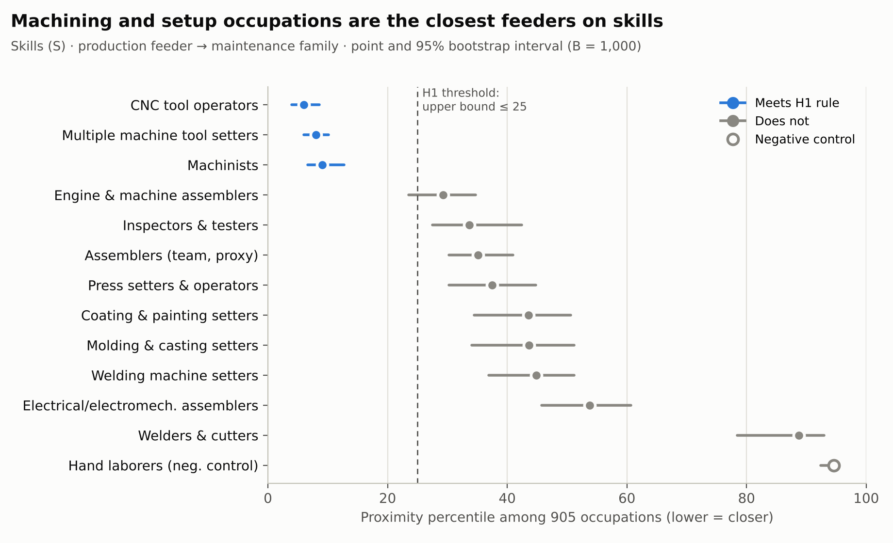
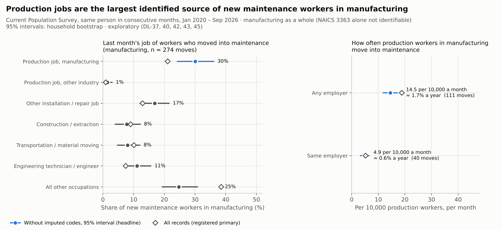
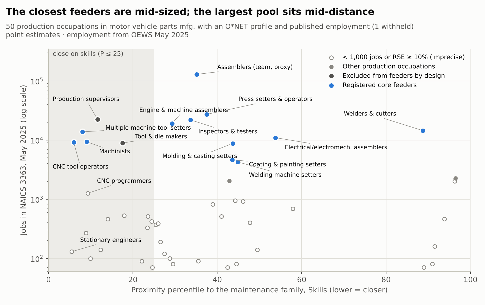
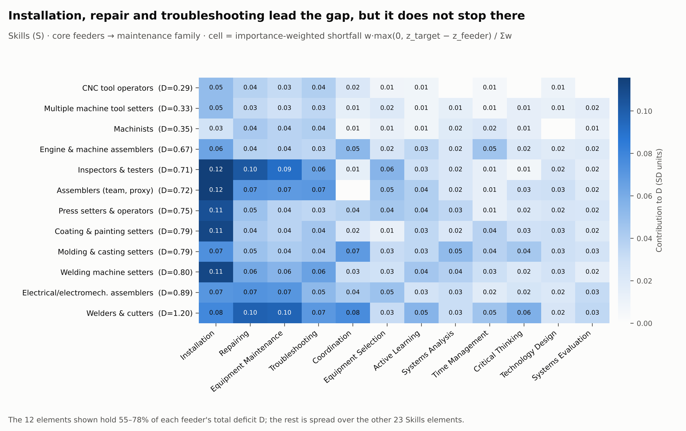
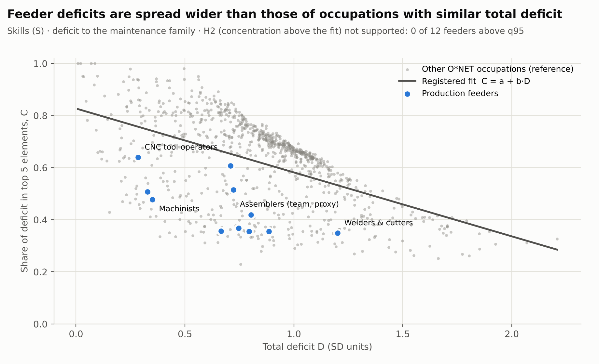
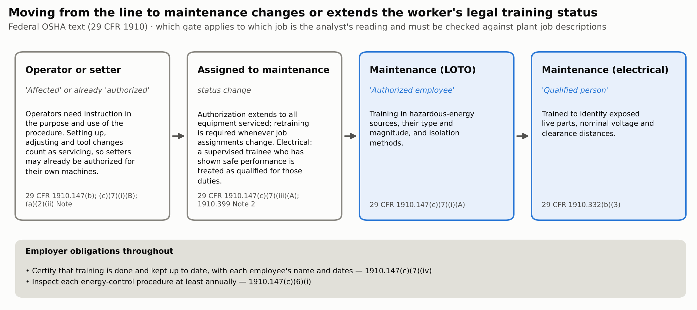
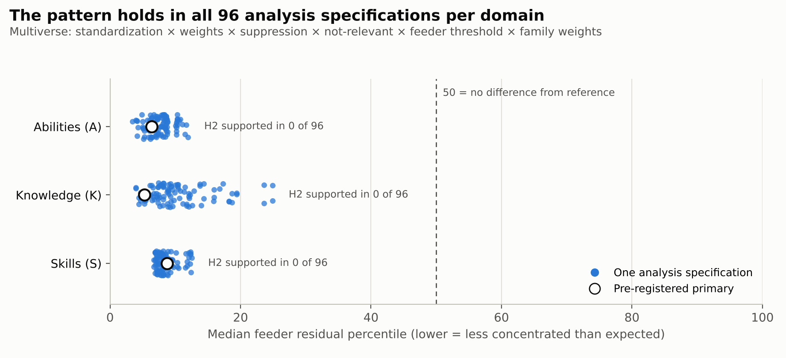
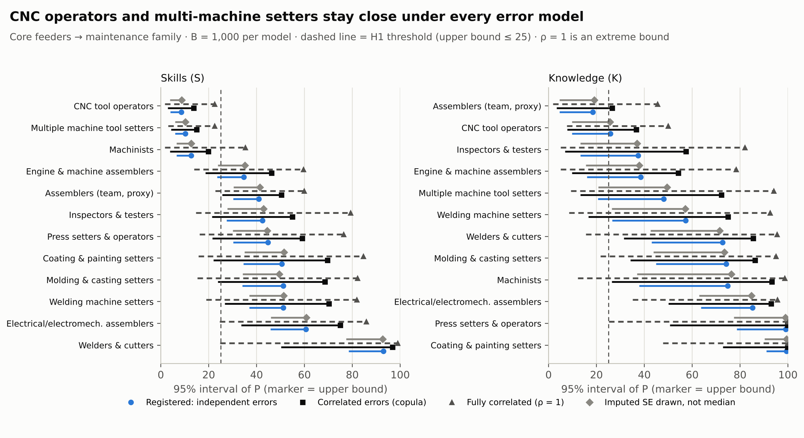
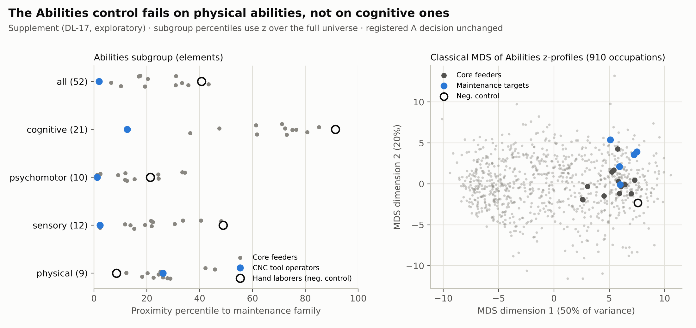

# Manufacturing Talent Supply Chain II-B
## From the Production Line to Maintenance — A Pre-registered Test of Skill Distance from Production to Equipment Maintenance (U.S. motor vehicle parts manufacturing, NAICS 3363)

<p align="center">
  <strong>In auto parts manufacturing, how close are production jobs to equipment maintenance, do workers actually move, and what does the move take?</strong><br>
  <em>O*NET 31.0 · OEWS May 2025 · BLS Employment Projections 2025–35 · CPS 2020–2026 · 29 CFR 1910 · pre-registered · bootstrap · 96-specification multiverse</em>
</p>

---

## 1. Motivation

This project began with the manufacturing workforce-ageing case of the 2023 Purdue HR Case Competition and continues the
earlier repository [*Manufacturing Talent Supply Chain at Risk (2010–2024)*](https://github.com/yechansota/Mfg_Talent_Supply_Chain.2010-2024.).
[II-A]([https://github.com/yechansota/Mfg_Talent_Supply_Chain_II.Floor_Succession](https://github.com/yechansota/Manufacturing_Talent_Supply_Chain_II-A)) covers the changing floor job mix,
ageing and worker flows, and a succession map for every floor job. This repository, II-B, tests in depth the one move
those results point to, production → equipment maintenance, with a pre-registered design. The frame, estimands and
decision rules were frozen before estimation (`config/prereg.yaml`, 2026-10-18, registered as *From the Line to
Maintenance*).

### Why production → equipment maintenance

**In practice.** Equipment maintenance keeps the production line running. Jobs in this industry fell between 2021 and 2025
(CES annual average 541.8k → 524.7k, −3.2%), yet industrial machinery mechanics inside the industry grew 12.2% over the
same period (OEWS May 2021–2025). BLS also projects mechanics to grow 4.5% inside the industry by 2035 while the industry
shrinks. But maintenance workers are not made overnight: 40.6% of incumbents in the maintenance family report more than a
year of on-the-job training (O*NET), and moving into maintenance changes a worker's legal status under the safety rules
(3.5). Starting development after a vacancy opens is too late. The answers here feed three decisions directly: **which
production jobs to recruit maintenance trainees from first**, **what the curriculum should cover**, and **how early to
start**.

**In theory.** The move tests two things.
- *Internal labour markets.* Internal labour market theory describes firms that hire into a few entry jobs and fill skilled
  jobs through internal promotion ladders (Doeringer & Piore, 1971). Production → maintenance is a candidate for such a
  ladder on the manufacturing floor. Whether that ladder actually works is the first question.
- *Distance between skill bundles.* Firm-specific skill arises from the *combination* of general skills, and the closer the
  combination a new job requires is to the one a worker already has, the less human capital is lost in the move (Lazear,
  2009). Empirical work shows that people move mostly to occupations with similar tasks (Gathmann & Schönberg, 2010, German
  administrative data) and that displaced workers who move to occupations with distant skill content lose more pay
  (Poletaev & Robinson, 2008, U.S. Displaced Worker Survey). This project's importance-weighted distance $D$ measures that
  "distance between combinations" with O*NET.

So this repository asks two questions with the same occupation definitions: is the move from production to maintenance a
*short* one in terms of skill bundles (pre-registered H1, H2), and does it actually happen (observed CPS moves)?

> **Problem statement.** The earlier repository concluded that a lack of binding mentoring cannot be shown with the
> industry-level data it used and that occupation-level (SOC) data are needed. Shortages are defined and measured by
> occupation (Barnow, Trutko & Schede Piatak, 2013), evidence of an economy-wide U.S. skill shortage is weak (Cappelli,
> 2015), and hiring difficulty in manufacturing is concentrated in some plants and specific skill demands (Weaver &
> Osterman, 2017). II-B takes that occupation-level step in depth for one move.

**Data.** Every input is a federal public statistic with documented methods. The pipeline re-runs from the raw files and
recomputes every reported number by a separate code path. Data and reproduction are in section 5.

### Questions this document answers
| # | Question | Short answer | Section |
|---|---|---|---|
| 1 | Which production jobs are closest to maintenance? | Machining and setup jobs: CNC tool operators, multiple machine tool setters and machinists, within the closest 13% of 905 occupations on Skills | 3.1 |
| 2 | Do production workers actually move into maintenance? What share of new maintenance workers come from production? | Yes. 31.5% (registered primary 22.0%) of those newly entering maintenance jobs in manufacturing were in production the month before, and 42.9% (28.8%) of those who moved within the same employer. Whether proximity predicts moves better is not established | 3.2 |
| 3 | Is the close pool large enough, and is it shrinking? | It is about the size of the maintenance family (32,370 vs 27,330 jobs) but shrank 23% in May 2021–2025 | 3.3 |
| 4 | What exactly is missing? | Installation, repairing, equipment maintenance and troubleshooting lead, but the gap is broad rather than a few modules (pre-registered H2 not supported) | 3.4 |
| 5 | What does the move take? | Time (40.6% of maintenance incumbents report more than a year of on-the-job training), a change of legal status (OSHA *affected* → *authorized* employee), and pay (a raise at the median, but a shrinking one) | 3.5 |

Each result is tagged with the kind of evidence behind it. **[Registered]** hypotheses frozen before estimation ·
**[Logged before]** exploratory analyses whose definitions were written in the deviation log before computing ·
**[Post hoc]** added or changed after seeing results (recorded as such in the log).

---

## 2. Key findings

1. **[Registered] The closest production jobs are the machining and setup jobs** (Figures 1, 7). On Skills, CNC tool
   operators, multiple machine tool setters and machinists stay within the closest 13% of 905 occupations even at the
   bootstrap upper bound (8.6, 10.2, 12.7), in **all** 96 specifications and under every error model tested (machinists
   drop out only when every rating error is assumed perfectly correlated). Welders and cutters are the farthest (P = 88.7).
2. **[Logged before] Production is the largest origin of new maintenance workers** (Figure 2). In linked CPS months
   (January 2020 – September 2026, manufacturing as a whole), 31.5% (26.0–37.6; registered primary 22.0%) of those newly
   entering maintenance jobs in manufacturing were in production the month before. It is the largest of the named origin
   groups, followed by other installation and repair jobs (16.9%). Among those who moved within the same employer the share
   is 42.9% (28.8%). Seen from production, about 14.5 per 10,000 workers move into maintenance each month, of whom 4.9 move
   within the same employer (about 0.6% a year). Whether machinists, the closest, move more often than other production
   workers is not established because the sample is small (1.48 times, 95% interval 0.48–2.92).
3. **[Registered] The remaining gap is broad, not a few modules** (Figures 4, 5). Pre-registered H2 is **not supported**.
   The feeders' deficits are *less* concentrated than those of occupations with the same total deficit (0 of 12 above the
   threshold on Skills and Knowledge, 1 on Abilities; 0 of 96 specifications in every domain). Even for CNC tool operators,
   the closest, 80% of the Skills deficit is spread over 6–10 elements (95% interval).
4. **The close pool is about the size of the maintenance workforce it would supply, but it is shrinking** (Figure 3). In
   3363 the three close feeders hold 32,370 jobs, similar to the maintenance family's 27,330, but they fell 23% in May
   2021–2025 (18% from May 2022; OEWS). Over the same period industrial machinery mechanics grew 12%. The largest feeder,
   team assemblers (129,460 jobs), is at a middle distance on Skills (P = 35.1).
5. **The move takes time and changes legal status** (Figure 6). In the maintenance family (employment-weighted), 40.6% of
   O*NET respondents report more than a year of on-the-job training, while most feeders' own median is 3–6 months. Moving
   into maintenance turns an OSHA *affected* employee into an *authorized* one, or widens a setter's authorization from
   their own machine to all equipment, with training, certification and retraining duties. Lockout/tagout is the
   third most cited OSHA standard in FY 2026 (preliminary).

> **What this means in practice.** A large part of the maintenance workforce already comes from production, and the share
> is larger still among moves within the same employer. The internal succession path is not a hypothesis but a route the
> labour market actually uses. The entry point is not the largest production job but the machining and setup jobs whose
> skill bundles are closest, and the bridge has to be a broad, apprenticeship-style path of a year or more, not a short
> add-on course. But the closest feeder, CNC tool operators, is a shared source for many floor jobs, so moving them needs a
> backfill plan (3.3).

### Figure guide
| Figure | What it shows | Section |
|---|---|---|
| 1 | How close each production feeder is to maintenance (H1) | 3.1 |
| 2 | Where new maintenance workers come from; how often production workers move | 3.2 |
| 3 | Proximity against pool size for every production occupation | 3.3 |
| 4 | Which skills each feeder lacks | 3.4 |
| 5 | Whether the gap is concentrated in a few skills (H2) | 3.4 |
| 6 | The legal training path from operator to maintenance worker (OSHA) | 3.5 |
| 7 | The result across 96 analysis specifications | 3.6 |
| 8 | The result under four measurement-error models | 3.6 |
| S1 | Why the Abilities negative control failed | 3.6 |

---

## 3. Detailed analysis and figures

> **How to read.** The *directional deficit $D$* adds up, element by element, how far an occupation *falls short* of the
> maintenance family, weighted by each element's importance in maintenance work (surplus skill does not offset). The
> *proximity percentile $P$* is the share of the 905 non-target occupations that fall short by no more than this
> occupation; **lower = closer**. Pre-registered H1 calls a feeder "close" when the bootstrap 97.5th percentile of $P$ is at
> most 25. Definitions and formulas are in section 5.

#### 3.1 Which production jobs are closest to maintenance? [Registered]



*How to read:* each row is a registered production feeder. The dot is its proximity percentile P to the maintenance family on Skills (lower = closer) and the bar its 95% bootstrap interval. The dashed line at 25 is the pre-registered H1 threshold: a feeder is "close" only when the whole bar ends left of it (blue). The open circle is the negative control (hand laborers), which should sit far right.

**Registered feeders (H1).**
| SOC | Feeder | Jobs in 3363 | Skills P [95% CI] | Specifications with P ≤ 25 | Knowledge P [upper] | Top three skill gaps |
|---|---|---|---|---|---|---|
| 51-9161 | CNC tool operators | 9,200 | **6.0 [4.0, 8.6]** | 100% | 16.2 [25.7] | installation, troubleshooting, repairing |
| 51-4081 | Multiple machine tool setters | 13,810 | **8.1 [6.0, 10.2]** | 100% | 28.2 [48.1] | installation, troubleshooting, repairing |
| 51-4041 | Machinists | 9,360 | **9.1 [6.6, 12.7]** | 100% | 48.4 [74.8] | repairing, troubleshooting, equipment maintenance |
| 51-2031 | Engine and other machine assemblers | 19,090 | 29.3 [23.5, 34.7] | 17% | 24.2 [38.5] | installation, operation and control, time management |
| 51-9061 | Inspectors and testers | 21,920 | 33.7 [27.5, 42.4] | 0% | 22.5 [37.5] | installation, repairing, equipment maintenance |
| 51-2090 | Assemblers (team, proxy) | 129,460 | 35.1 [30.3, 41.0] | 0% | **9.4 [18.5]** | installation, repairing, troubleshooting |
| 51-4121 | Welders and cutters | 14,470 | 88.7 [78.4, 92.9] | 0% | 55.6 [72.7] | repairing, equipment maintenance, installation |

All 12 feeders: `outputs/layers/decision_table.csv`. On Knowledge, "close" means "falls short less", not "similar" (4.2).
Abilities are not interpreted because the negative control failed (3.6).

**Top 10 of all production occupations employed in 3363 (Skills, point estimates; DL-12).** Not only the registered frame
but every SOC-51 detailed occupation with 3363 employment and an O*NET profile (51 of 53) is ranked.
| Rank | SOC | Occupation | P | Jobs in 3363 | Usable as a pool? |
|---|---|---|---|---|---|
| 1 | 51-8021 | Stationary engineers and boiler operators | 5.5 | 130 | small (< 1,000) |
| 2 | 51-9161 | CNC tool operators | 6.0 | 9,200 | yes |
| 3 | 51-4081 | Multiple machine tool setters | 8.1 | 13,810 | yes |
| 4 | 51-4023 | Rolling machine setters | 8.8 | 270 | small |
| 5 | 51-4041 | Machinists | 9.1 | 9,360 | yes |
| 6 | 51-9162 | CNC tool programmers | 9.3 | 1,260 | imprecise estimate |
| 7 | 51-8031 | Water and wastewater treatment plant operators | 9.9 | 100 | small |
| 8 | 51-1011 | First-line supervisors of production workers | 11.6 | 22,500 | excluded by design (supervisory) |
| 9 | 51-5112 | Printing press operators | 12.4 | 140 | small |
| 10 | 51-9021 | Crushing, grinding and polishing machine setters | 14.0 | 460 | small |

"Small or imprecise" = fewer than 1,000 jobs in 3363, employment relative standard error of 10% or more, or employment
withheld. Six of the ten closest have fewer than 1,000 jobs in the industry or an imprecise estimate and cannot carry a
pipeline. That is why size matters as much as proximity.

#### 3.2 Do production workers actually move into maintenance? [Logged before]



*How to read:* left — the occupation, one month earlier, of workers who just entered maintenance in manufacturing; the blue row (production in manufacturing) is the largest named origin. Right — how many production workers per 10,000 move into maintenance each month, for any employer and for the same employer. In both panels the filled dot and bar are the headline (no imputed codes) with its 95% interval, and the diamond is the registered all-records estimate; read the two as a range.

**How it was measured.** The CPS (Current Population Survey) interviews a household in consecutive months, so the
occupation of a person's main job can be compared across two consecutive months. A respondent who reports the same
employer and unchanged duties keeps last month's occupation code (dependent interviewing), which reduces spurious moves
from coding error (Moscarini & Thomsson, 2007). Respondents are also asked whether they still work for last month's
employer (PUIODP1). From 80 months of microdata, January 2020 (start of the 2018 Census occupation codes) to September
2026, the pipeline reads 3,773,834 employed person records and forms 2,374,459 consecutive-month pairs using the household
and person keys of the Census linking guide and consistency checks on month in sample, sex and age (link rate 83.7–86.2% by
year). The design and checks were recorded before the data were obtained (DL-37, DL-40).

- Maintenance jobs: 2018 Census occupation codes 6355, 7330, 7340, 7350, 7360 (the five registered targets; 7330 also
  contains refractory materials repairers, 49-9045).
- Production: codes whose SOC begins with 51. Of the closest feeders only machinists (8030) have their own code. CNC tool
  operators share a code with CNC tool programmers (7905), and multiple machine tool setters share one with other metal
  and plastic workers (8225).
- Scope: manufacturing as a whole. CPS industry 3570 combines NAICS 3361–3363, so 3363 cannot be isolated, and 3570 alone
  falls below the reporting standard (22 maintenance entrants).
- Intervals: household bootstrap, B = 1,000 (approximate, because the public files carry no design variables). Reporting
  standard: NCHS data presentation standards for proportions (n ≥ 30, at least one event, interval-width rules).
- **Headline rule [Post hoc, DL-42].** The headline is the estimate without pairs whose occupation or industry code was
  imputed in either month; the registered primary (all records) is shown beside it. Pairs with an imputed code show a
  change of occupation 68.8% of the time, 15 times the rate without (4.6%), and 166 of the 440 maintenance entrants have an
  imputed code (`outputs/cps_moves/allocation_diagnostic.csv`). This decision was made after seeing results and does not
  favour one side (Q2 rises, Q1 and Q3 fall). Imputation arises from non-response, so excluding it is not a neutral choice
  either. Read the two values as a range.

**Where new maintenance workers come from (DL-43).** Last month's occupation of those newly entering maintenance jobs in
manufacturing.
| Last month's occupation | Headline (no imputed codes, n = 274) | Registered primary (n = 440) | Same employer (headline, n = 90) |
|---|---|---|---|
| **Production, manufacturing** | **30.1%** (24.3–36.1) | 21.1% | **42.3%** (31.0–54.1) |
| Production, other industry | 1.5% | 0.9% | 0.5% |
| Other installation, maintenance and repair (incl. helpers) | 16.9% (12.1–21.6) | 12.9% | below reporting standard |
| Engineering technicians and engineers | 11.1% (7.0–15.6) | 7.4% | below reporting standard |
| Transportation and material moving | 8.0% | 10.1% | below reporting standard |
| Construction and extraction | 7.7% | 9.0% | below reporting standard |
| All other occupations | 24.7% (19.3–30.8) | 38.5% | 23.7% (14.3–34.3) |

The two production rows add up (before rounding) to Q2. People entering maintenance from unemployment or from outside the
labour force are not in this table's universe (employed in both months).

**Summary.**
| Measure (manufacturing as a whole) | Headline (no imputed codes) | Registered primary | Events / base (headline) |
|---|---|---|---|
| Q2 share of maintenance entrants who were in production the month before | **31.5%** (26.0–37.6) | 22.0% (18.0–26.5) | 88 / 274 |
| Q2, same employer | **42.9%** (31.6–54.5) | 28.8% (20.8–37.2) | 39 / 90 |
| Q1 moves into maintenance per 10,000 production workers a month | **14.5** (11.8–17.2) | 18.8 (15.8–22.0) | 111 / 78,193 |
| Q1, same employer | **4.9** (3.3–6.6) · about 0.6% a year | 5.2 (3.7–7.0) | 40 / 78,193 |
| Q3 rate ratio, machinists vs other production | 1.48 (0.48–2.92) | 1.75 (0.79–3.02) | 9 vs 92 |

Annualization is $1-(1-p)^{12}$ (assuming a constant monthly rate $p$).

**Why moves within the same employer are shown separately [Post hoc, DL-46].** Q1 without regard to employer includes moves
into maintenance jobs outside manufacturing, because some maintenance occupations work mostly outside manufacturing. In
OEWS May 2025, general maintenance and repair workers (49-9071) number 1,529,700, of whom 206,760 (13.5%) are in
manufacturing, and the largest sector is real estate and rental and leasing; electricians (47-2111) are 6.9% in
manufacturing, and the largest sector is construction. Industrial machinery mechanics (53.1%) and machinery maintenance
workers (54.1%) are more than half in manufacturing (`outputs/cps_moves/m_codes_by_sector.csv`). Moves within the same
employer are the closest measure of in-plant succession.

**A sense of scale [Post hoc illustration, DL-45].** Applying the national manufacturing same-employer rate (about 0.59% a
year) to production employment in 3363 (331,270, OEWS May 2025) gives about 1,950 a year (1,320–2,610). That is the same
order of magnitude as the maintenance family's illustrative annual separations of about 2,150 (of which about 980 are
labour-force exits; 3.3). The illustration rests on the assumption that the 3363 rate equals the manufacturing rate and is
not an estimate of 3363 flows. What the comparison can support is that internal moves are not negligible relative to
replacement need.

**Checks (four, fixed in advance).** Counting only moves still in maintenance the following month gives Q1 = 15.3 per
10,000; excluding March 2020 – December 2021 gives 19.4; excluding imputed codes gives 14.5. The conclusion that moves are
observed holds. Industry 3570 alone gives a Q2 denominator of 22, below the reporting standard. Q2 exactly as written in
DL-37 (manufacturing the month before) is 39.8%, higher because by definition it leaves out entrants from outside
manufacturing (DL-40).

**What this cannot show.** Results for 3363 alone, causation, employers' succession intent, performance after the move, and
whether proximity predicts moves (Q3 points above 1 but its interval includes 1, so it is not established). Because moves
are observed month to month, a two-step path through maintenance helper jobs (7610) is not counted as a move into
maintenance.

**What practitioners can still use.**
1. **The path is real and measurable.** Even within the same employer, about 5 per 10,000 production workers move into
   maintenance each month.
2. **Production is the largest source of new maintenance workers.** Within the same employer it supplies about 3–4 of every
   10 new maintenance workers (28.8–42.9%). Internal production workers are not a marginal source in maintenance workforce
   planning.
3. **"Recruit from the closest jobs first" rests on skill distance (H1), not on validated movement data.** Run it as a pilot
   and record completion and retention by origin job; the plant can then answer Q3, which these data could not.
4. **What to teach (a broad gap, 3.4) and how long it takes (more than a year, 3.5) hold regardless of Q3.**

`outputs/cps_moves/`.

#### 3.3 Is the close pool large enough, and is it shrinking?



*How to read:* each dot is a production occupation employed in auto parts. Left–right is proximity to maintenance on Skills (the shaded band at P ≤ 25 is "close"); up–down is the number of jobs in the industry (log scale). Blue dots are the registered core feeders. The ideal source sits top-left — close and large; the closest feeders are mid-sized, and the largest pool (team assemblers) sits in the middle of the distance axis. Open circles are too small or imprecise to carry a pipeline.

| Quantity (NAICS 3363, national) | Value | Basis |
|---|---|---|
| Maintenance family employment | 27,330 | OEWS May 2025 |
| Close feeder pool (meets Skills H1: 51-9161, 51-4081, 51-4041) | 32,370 | OEWS May 2025 |
| Employment of the 12 core feeders | 273,210 | OEWS May 2025 |
| Illustrative annual separations, maintenance family | ≈ 2,146 (labour-force exits ≈ 981) | 3363 employment × EP all-industry separation rates; assumes 3363 rates equal national rates |
| Separations ÷ close pool | 6.6% a year | share of the close pool that would have to move each year if it were the only source |
| Illustrative annual moves from the close pool to another SOC major group | ≈ 1,840 | 3363 employment × EP all-industry occupational transfer rates (5.4–6.1%); destination unknown |

Proximity and headcount are shown side by side, not multiplied into an "effective supply" index. BLS counts an
occupational transfer only when a worker moves to another SOC major group and does not report the destination
([BLS separations FAQ](https://www.bls.gov/emp/documentation/separations-faqs.htm)). Labour-force exits are where ageing
enters these data: BLS counts people leaving the labour force, for example to retire, as labour-force exits and explains
that the likelihood of leaving rises as workers approach traditional retirement ages (same source). The team assembler
pool is large but at a middle distance on Skills and close on Knowledge (P = 9.4). That result holds on element subsets but
not under correlated rating errors (3.6).

**The pool is shared (II-A 3.5).** The closest feeder, CNC tool operators, is the close successor source for 13 of 33 floor
jobs and the only close source for multiple machine tool setters and automotive service technicians, and no job is close
enough to succeed them (nearest P 38). Each CNC tool operator who moves into maintenance therefore leaves a place no close
internal job can fill. BLS projects this job to shrink (−10% against the industry baseline), but observed employment grew
35.5% in May 2021–2025 (14.0% from May 2022).

**Observed change, OEWS May 2021–2025 (DL-29).** The close pool fell from 41,970 to 32,370 jobs (−22.9%). Machinists
(−40.6%) and multiple machine tool setters (−28.9%) were partly offset by CNC tool operators (+35.5%), the shift from
conventional to CNC machining that BLS also expects. Over the same period industrial machinery mechanics grew 12.2%. The five
years use the same estimation method, but BLS does not encourage comparing OEWS estimates over time, so these are observed
differences, not trends. Counting from May 2022 the pool fell 18.0% (DL-32).

#### 3.4 What exactly is missing? [Registered]



*How to read:* rows are core feeders (with their total deficit D), columns the skill elements that contribute most. A darker cell means a larger shortfall on that element relative to the maintenance family, weighted by how important it is in maintenance work. The first columns (installation, repairing, equipment maintenance, troubleshooting) are dark for almost every feeder, but many other cells are also shaded: the gap is broad.



*How to read:* each grey dot is an O*NET occupation: total deficit D across, and the share of that deficit in its five largest elements (C) up. The line is the registered fit — the concentration expected for a given total deficit. Blue dots are the production feeders. H2 predicted they would sit well above the line (a gap concentrated in a few modules); they sit at or below it, so H2 is not supported.

| | Skills | Knowledge | Abilities |
|---|---|---|---|
| Feeders above the reference residual q95 (H2; 3 or more needed) | 0 of 12 | 0 of 12 | 1 of 12 |
| Median feeder residual percentile (50 = no difference) | 8.7 | 5.3 | 6.4 |
| Range of core-feeder 95% intervals — $N_{\text{eff}}$ | 7.6–24.1 | 2.5–17.0 | 9.7–38.1 |
| — $\exp(H)$ | 9.7–27.9 | 3.6–20.8 | 13.0–42.4 |
| — $k_{80}$ (elements needed for 80% of D) | 6–20 | 3–14 | 9–30 |

The 12 elements in Figure 4 account for 55–78% of each feeder's Skills deficit; the rest is spread over the other 23. The
three breadth measures agree. On Knowledge the two closest feeders (team assemblers, CNC tool operators) have narrower gaps
($k_{80}$ 3–7) but are not more concentrated than occupations with the same total deficit.

> **Interpretation.** "Broad" has an economic meaning as well as a technical one. A gap spread over a dozen skills is
> mostly *general* human capital that workers can take to other employers. Becker predicts that in a competitive labour
> market firms do not pay for general training; workers bear it through lower pay while training (Becker, 1962). That is
> why the make-or-buy decision is hard. These data do not measure training costs, so they cannot show whether internal
> training costs more than hiring.

#### 3.5 What the move takes: time, legal status, pay

**Time.** O*NET Training & Experience: share of respondents in each occupation reporting more than a year (DL-21).
| | Job Zone | Median on-the-job training | > 1 year: on-the-job training | > 1 year: on-site training | > 1 year: related work experience |
|---|---|---|---|---|---|
| Industrial machinery mechanics | 3 | 6–12 months | 43.8% | 40.2% | 76.3% |
| Maintenance and repair workers, general | 3 | 1–3 months | 22.4% | 20.3% | 96.5% |
| Electricians | 3 | 1–2 years | 71.5% | 41.4% | 49.9% |
| Maintenance workers, machinery | 3 | 3–6 months | 29.3% | 23.7% | 81.8% |
| Millwrights | 2 | 2–4 years | 66.7% | 54.5% | 54.5% |
| **Maintenance family (employment-weighted)** | | | **40.6%** | **34.1%** | **78.8%** |
| CNC tool operators | 2 | 6–12 months | 31.6% | 26.8% | 50.7% |
| Multiple machine tool setters | 2 | 3–6 months | 40.0% | 34.1% | 36.0% |
| Machinists | 3 | 3–6 months | 24.0% | 33.0% | 61.8% |
| Assemblers (team, proxy) | 2 | 3–6 months | 16.1% | 17.1% | 32.4% |

Job Zone 2 is O*NET 31.0's merged band "1–2: little or some preparation needed"; 3 is "medium preparation needed". These
figures are the time to proficiency for anyone entering each occupation, not the time it takes a CNC tool operator to
become a mechanic. No public cost data exist at this level, so they are not converted to money. BLS assigns long-term
on-the-job training or apprenticeship to four of the five targets and moderate-term on-the-job training to 11 of the 12
feeders.

**Legal status.**



*How to read:* read left to right as a career path. The four boxes are the training statuses under 29 CFR 1910: operator or setter (an *affected* employee, or a setter already *authorized* for their own machine) → assigned to maintenance (the status change, with retraining) → maintenance, lockout/tagout (*authorized* employee) → maintenance, electrical (*qualified* person). Each box gives what the regulation requires and the citation; blue boxes are the maintenance end states. The strip along the bottom lists the employer's duties throughout. The point: the move into maintenance is also a change of legal status with its own training and certification steps.

1. **KSA ratings do not see legal status.** O*NET rates what a job requires; it does not record that under the lockout/tagout
   standard an operator is an *affected* employee who need only be instructed in the purpose and use of the procedure
   (1910.147(c)(7)(i)(B)). A maintenance worker is an *authorized* employee who must be trained in the recognition of
   hazardous energy sources, their type and magnitude, and the means of isolation (1910.147(c)(7)(i)(A)). Setting up,
   adjusting and tool changes count as servicing (1910.147(b)), with only routine minor servicing done under alternative
   protection exempted ((a)(2)(ii) Note). So a setter may already be an *authorized* employee for the machines they set
   up. O*NET supports this distinction: on the higher of the Importance of repairing and of equipment maintenance, CNC tool
   operators, multiple machine tool setters and coating setters are "important" (≥ 3.0), the other feeders 1.75–2.88
   (machinists 2.88), and the maintenance targets 3.50–4.00 (DL-24).
2. **The transition itself creates duties.** Retraining is required whenever job assignments change
   (1910.147(c)(7)(iii)(A)), the employer must certify that training has been accomplished and kept up to date, with the
   employee's name and dates (1910.147(c)(7)(iv)), and each energy control procedure must be inspected at least annually
   (1910.147(c)(6)(i)).
3. **This is not paperwork.** Lockout/tagout (29 CFR 1910.147) is the third most cited OSHA standard in FY 2026
   (preliminary, October 1, 2025 – August 31, 2026) ([OSHA](https://www.osha.gov/top10citedstandards)).
4. **Staged training has a legal basis.** In electrical work, a trainee who has demonstrated the ability to perform duties
   safely at their level of training and works under the direct supervision of a qualified person is considered a qualified
   person for those duties (1910.399, "Qualified person", Note 2).
5. **Choosing who enters training is a regulated selection step.** The Uniform Guidelines cover selection procedures used
   for promotion and the selection for training that leads to it
   ([29 CFR 1607.2(B)](https://www.law.cornell.edu/cfr/text/29/1607.2)).

The applicability coding is an analyst's reading grounded in O*NET maintenance ratings and must be checked against plant
job descriptions.

**Pay.** OEWS May 2025, NAICS 336300, median hourly wage. Maintenance family ≈ \$32.66 (employment-weighted mean of the
targets' medians; an approximation).
| Feeder | Median | Difference to the family |
|---|---|---|
| CNC tool operators | \$22.91 | +\$9.75 (+42.6%) |
| Multiple machine tool setters | \$23.05 | +\$9.61 (+41.7%) |
| Machinists | \$26.09 | +\$6.57 (+25.2%) |
| Engine and other machine assemblers | \$29.10 | +\$3.56 (+12.2%) |
| Assemblers (team, proxy) | \$20.97 | +\$11.69 (+55.7%) |
| *Tool and die makers (excluded by design)* | \$35.02 | −\$2.36 |
| *Production supervisors (excluded by design)* | \$33.72 | −\$1.06 |

Every core feeder earns less than the family at the median. Medians cannot show whether this difference makes up for the
earnings lost during training, and that self-selection question (Roy, 1951) is outside these data. The raise is also
shrinking. In May 2021–2025, the mean hourly wage of industrial machinery mechanics went from 46% to 24% above that of
multiple machine tool setters (z = −12.4) and from 23% to 16% above machinists (z = −6.1). The change against CNC tool
operators (+39% → +34%) is within what sampling error and the choice of start year can produce (z = −2.2 from 2021, −0.8
from 2022).

#### 3.6 How robust are the results?



*How to read:* each small blue dot is one of the 96 analysis specifications per domain (different standardization, weights, rating filters, thresholds); the open circle is the pre-registered primary. The horizontal position is the median feeder residual percentile: left of the dashed line at 50 means feeder gaps are less concentrated than expected. The text gives how many specifications support H2 — 0 of 96 in every domain.

**Multiverse.** Standardization × weights × low-precision ratings × "not relevant" level × feeder threshold × family
weights = 96 specifications per domain. H2 is supported in 0 of 96 specifications in every domain. The validity check gives
the same verdict in all 96. The three machining and setup feeders have P ≤ 25 on Skills in all 96.



*How to read:* left Skills, right Knowledge. Each feeder has four bars, one per measurement-error model (blue = registered independent errors; the others assume correlated, fully correlated or redrawn standard errors); the marker is the upper bound used by H1, and the dashed line at 25 is the threshold. CNC tool operators and multiple machine tool setters stay left of the line under every model; the Knowledge result for team assemblers does not.

**Error models (DL-15, DL-19).** Upper bound of P, B = 1,000 each:
| Feeder (domain) | Registered: independent errors | Correlated errors (copula) | Perfectly correlated (ρ = 1) | Imputed-SE draws |
|---|---|---|---|---|
| CNC tool operators (S) | 8.6 | 13.8 | 22.4 | 8.7 |
| Multiple machine tool setters (S) | 10.2 | 14.9 | 22.4 | 10.2 |
| Machinists (S) | 12.7 | 19.9 | 35.3 | 12.6 |
| Assemblers, team (K) | 18.5 | 26.5 | 45.4 | 19.0 |
| Median interval width, core feeders (S / K) | 14.4 / 23.3 | 35.6 / 49.9 | 60.7 / 74.1 | 14.4 / 23.0 |

Correlated errors widen the intervals two to four times. The copula correlation is an upper-bound proxy taken from ratings
across occupations. The Skills verdicts hold except machinists at ρ = 1; the only Knowledge verdict (team assemblers) does
not hold under correlated errors.

**Continuous distances (DL-16).** Skills point percentiles of the three feeders: directional $D$ 6.0 / 8.1 / 9.1;
importance-weighted Euclidean 4.9 / 3.0 / 2.3; Mahalanobis (Ledoit–Wolf) 9.6 / 1.5 / 1.0. Non-directional distances call
far more feeders close (Euclidean 11 of 12, Mahalanobis 7, directional $D$ 3). Production jobs broadly *resemble*
maintenance jobs; the directional deficit picks out the jobs that *have what maintenance needs*.

**Rating vintage (DL-20).** Dropping every occupation rated before 2018 (171 of 910), the three close Skills feeders have
P = 5.4 / 7.5 / 8.3, and the H2 exceedances are unchanged (S 0, K 0, A 1).

**Does it rest on particular elements or targets? (DL-27).** Point estimates, seed 20261007:
| Check | Skills | Knowledge |
|---|---|---|
| 500 random half-splits of the elements: share of 1,000 half-sets with P ≤ 25 | CNC 98.9%, multiple machine setters 97.5%, machinists 95.9% | team assemblers 99.4%; CNC 71.5%, inspectors 62.5% |
| Both halves give the same closest three | 99.4% | 6.4% |
| Rank agreement of core feeders between halves (median Spearman; Spearman–Brown) | 0.72; 0.84 | 0.93; 0.96 |
| Leave one element out | same three in all 35; highest P 12.0 | team assemblers first in all 33 |
| Leave one maintenance target out | same three in all 5 | team assemblers first in all 5 |
| H2 under polynomial fits (degree 1–3) and local 95th percentiles (50/100/200 nearest in D) | 0 of 12 under every form | 0 of 12 under every form |

**Multiple testing (registered setting; DL-32).** Applying the pre-registered FDR q = 0.05 with bootstrap p-values
$p = (\#\{P^{*} > 25\} + 1)/(B + 1)$ and Benjamini–Hochberg over the 24 Skills and Knowledge tests, all four "close"
verdicts hold (each p = 0.001, adjusted 0.006), and the same under Bonferroni.



*How to read:* left — proximity of each feeder (grey), CNC tool operators (blue) and the negative control, hand laborers (open circle), computed separately within each Abilities subgroup. Hand laborers look close on physical abilities but far on cognitive ones. Right — a two-dimensional map (classical MDS) of all 910 occupations' Abilities profiles, with feeders and maintenance targets highlighted. The control fails because of shared physical demands, so Abilities are not interpreted.

**Why the Abilities control failed (DL-17).** Hand laborers have P = 8.5 on physical abilities, 21.3 on psychomotor and 91.4
on cognitive abilities. The failure comes from shared physical demands.

#### 3.7 Pre-registered hypotheses: results
| Hypothesis | Rule (fixed before estimation) | Result |
|---|---|---|
| **Validity check** | hand laborers' P ≥ 50 | K (67.6) and S (94.6) **pass**; A (40.7) **fails**, so H1 is not interpreted on Abilities |
| **H1** proximity | bootstrap 97.5th percentile of P ≤ 25 | **S:** CNC 8.6, multiple machine setters 10.2, machinists 12.7 · **K:** team assemblers 18.5 (CNC 25.7, just outside) · all four hold at BH q = 0.05 |
| **H1-group** (defined after seeing the feeder estimates — not blind) | mean P of machining + welding < assembly; exact permutation, 120 | **Not supported.** S: −5.4, p = 0.375 · K: +12.0, p = 0.717 |
| **H2** concentration (primary) | 3 or more of 12 above the reference residual 95th percentile | **Not supported.** 0 / 0 / 1 (S / K / A); 0 of 96 specifications in every domain |
| *Observed moves (logged before, not registered)* | *machinists' rate ratio > 1 (logged in DL-37 before the data)* | *right direction, interval includes 1 (headline 1.48, 0.48–2.92; registered primary 1.75, 0.79–3.02) — not established* |

---

## 4. Considerations, constraints and recommendations

### 4.1 Recommendations for practitioners
1. **Recruit maintenance trainees first from the machining and setup jobs** (CNC tool operators, multiple machine tool
   setters, machinists). This is not a call to invest in these jobs or to rank people; it is about *where to post the
   trainee openings first*. Recruiting is outside the scope of the rules on individual selection
   ([29 CFR 1607.2(C)](https://www.law.cornell.edu/cfr/text/29/1607.2)). Treat team assemblers as a second, longer path: a
   large pool, close on Knowledge (holds on element subsets, not under correlated errors) but farther on Skills (3.1, 3.3).
2. **Treat internal production workers as the main source in maintenance workforce planning.** About 3–4 of every 10 new
   maintenance workers moving within the same employer already come from production (3.2). Recording completion and
   retention by origin job lets the plant answer "do closer jobs move better?" (Q3), which these data could not.
3. **Design the bridge as a broad, staged programme, not one course, and start early.** Begin with installation,
   repairing, equipment maintenance and troubleshooting, but plan for the remaining skills too (3.4). Because 40.6% of
   maintenance incumbents report more than a year of on-the-job training, start at least one to two years before the
   expected retirement (3.5).
4. **Build the legal path into the programme.** Define the move from *affected* to *authorized* (for electrical work,
   *qualified*) employee, or the widening of a setter's existing authorization to all equipment: a supervised trainee
   stage, certification records with names and dates, retraining on reassignment, and annual procedure inspections (3.5).
5. **Manage entry into the programme as a selection procedure.** Use job-related criteria and check for adverse impact
   ([29 CFR 1607.2(B)](https://www.law.cornell.edu/cfr/text/29/1607.2)). These results describe occupations, not
   individuals, so do not use them to screen individuals.
6. **Plan the backfill before moving CNC tool operators.** They are a shared source for many floor jobs and have no close
   internal successor (3.3).

**Pathway table (layers side by side, never combined into a score).** `outputs/practice/pathway_table.csv`
| Feeder | Skills P (upper) | Jobs in 3363 | Change inside 3363, 2025–35 | Median wage gap to the family | Own median OJT | O*NET maintenance "important" |
|---|---|---|---|---|---|---|
| CNC tool operators | 8.6 | 9,200 | −21.6% | +\$9.75 | 6–12 months | yes (3.00) |
| Multiple machine tool setters | 10.2 | 13,810 | −12.9% | +\$9.61 | 3–6 months | yes (3.12) |
| Machinists | 12.7 | 9,360 | −12.9% | +\$6.57 | 3–6 months | no (2.88) |
| Engine and other machine assemblers | 34.7 | 19,090 | −23.4% | +\$3.56 | 3–6 months | no (2.88) |
| Assemblers (team, proxy) | 41.0 | 129,460 | −12.9% | +\$11.69 | 3–6 months | no (2.25) |
| Inspectors and testers | 42.4 | 21,920 | −12.9% | +\$10.03 | 3–6 months | no (1.75) |
| Press setters and operators | 44.8 | 27,220 | −21.6% | +\$10.86 | 1–3 months | no (2.75) |

"Change inside 3363, 2025–35" is a BLS projection, and BLS's past projections for this industry were below the outcome in
all four checkable vintages (II-A 3.1). Read it as a direction, not a level.

### 4.2 Constraints and limitations
- **Occupations, not people.** O*NET ratings are occupation averages across all industries, and individuals differ.
- **Proximity and actual moves.** The CPS shows that production → maintenance moves happen, but whether proximity predicts
  moves better is not established because the sample is small (9 moves by machinists). The CPS cannot isolate 3363, and
  two of the three close feeders share a code with other occupations. Region, union rules, seniority, pay and worker
  preferences all shape moves.
- **Nature of the CPS data.** The sampling unit is the housing unit, so people who move are not linked (Census linking
  guide). The estimate without imputed codes differs from the all-records estimate (3.2), and neither is the true value.
- **Industry scope.** Employment weights, wages and NEM projections are specific to 3363; KSA ratings, training times and EP
  all-industry rates are economy-wide; the CPS covers manufacturing as a whole.
- **Meaning of Knowledge.** The directional deficit gives values near 0 to occupations with generally high knowledge, so
  "close" on K means "falls short less". Knowledge ratings of 257 occupations have no published SE and were imputed (no
  verdict changed under DL-19).
- **Measurement error.** The true within-occupation error correlation is unknown. Under the upper-bound copula proxy the
  Skills verdicts hold and the Knowledge verdict does not.
- **Weights.** 49-9041 and 49-9071 carry 78% of the family weight, and 51-2090 (team assembler proxy) holds 47% of feeder
  employment. Equal weights are in the multiverse.
- **Training time and cost.** O*NET categories are not feeder-specific transition times, and no public cost data exist.
- **Pay and selection.** Median wage gaps cannot say why people do or do not move (Roy-type self-selection).
- **Accumulated analysis choices.** Implementation readings and additions after the freeze make up 48 log entries (DL-1 …
  DL-48). Each is recorded with its timing relative to the run, and every results table separates [Registered],
  [Logged before] and [Post hoc]. Post-hoc items (H1-group, the CPS headline rule, the 3363 scale illustration) are not used
  as confirmatory evidence.

### 4.3 What was not covered, and what was tried but not used
| Item | Reason | Used instead |
|---|---|---|
| Actual moves between occupations (Census J2J) | J2J has no occupation dimension ([J2J quickstart](https://lehd.ces.census.gov/doc/J2J_quickstart_guide.pdf)) | CPS monthly linked data (3.2) |
| Actual moves within 3363 (CPS industry 3570) | 3570 combines NAICS 3361–3363, and only 22 maintenance entrants fall below the reporting standard | manufacturing as a whole |
| Calling the successor pool "internal" | O*NET, OEWS and EP describe occupations in the labour market, not a company's workforce | "occupations adjacent in the labour market" |
| A multiplicative succession-risk index | no benchmark to validate it, and no units | interpretable measures side by side (pathway table) |
| A "shortage" frame | excess demand cannot be measured | distance, demand, pay and training time as separate layers |
| Predictive power of proximity for moves (Q3) | tried, but the sample is too small to decide (interval includes 1) | next steps (4.4) |

### 4.4 Next steps
- **Extending predictive validity.** Re-test the link between proximity and actual moves on a longer CPS sample (including
  2011–2019 under the 2010 codes, which needs a code crosswalk).
- **Convergent validity.** Compare the close feeders with O*NET 31.0 *Related Occupations*.
- **Training cost.** Convert time to proficiency into cost (only occupation-level time categories are public now).
- **Self-selection.** Identify who moves and why with worker-level pay and mobility data.
- **Plant validation.** Check the top deficit elements and the OSHA applicability coding with maintenance supervisors
  (subject to employer approval and an IRB determination).

---

## 5. Data, methods and reproduction

**Why public data only.** Every input is a federal public statistic with documented methods. No employer or private data
are used, so anyone can download the same files and reproduce every number. The registered inputs are frozen by SHA-256,
the pipeline re-runs from scratch, and the output audit recomputes every reported number by a separate code path. Public
data do not remove error, so the published standard errors are carried with each estimate.

**Data.**
| Data | Version | Use |
|---|---|---|
| O*NET Knowledge (33), Skills (10 essential + 25 transferable = 35), Abilities (52) | 31.0 | Level and Importance ratings with standard errors for 910 rated occupations |
| O*NET Training & Experience, Job Zones | 31.0 | time to proficiency (on-the-job training, on-site training, related work experience) |
| OEWS, NAICS 336300 | May 2025 (+ May 2021–2024) | employment and median wages inside the industry (538,980 jobs); observed change of the close pool |
| BLS Employment Projections | 2025–35 | separations (labour-force exits, occupational transfers), employment change, training categories, change factors |
| BLS National Employment Matrix, industry 336300 | 2025–35 | 2025 and 2035 employment by occupation inside the industry |
| CPS basic monthly public-use microdata (Census) | January 2020 – September 2026 (October 2025 not collected) | the same person's occupation in consecutive months |
| Census 2018 occupation code list; 2017 and 2022 industry code lists | — | linking CPS codes to SOC and NAICS |
| BLS O*NET-SOC ↔ NEM crosswalk | as of 2026-08-27 | linking O*NET, EP and OEWS codes (23/23 frame codes checked) |
| 29 CFR 1910.147, 1910.332, 1910.399; 29 CFR 1607.2 | current | training-status gates and the scope of selection procedures |

**Frame (selected by rule before any KSA computation).** The five maintenance targets (industrial machinery mechanics,
general maintenance and repair workers, electricians, machinery maintenance workers, millwrights) are combined into one
**maintenance family** weighted by 3363 employment (π = 48.3 / 29.9 / 10.7 / 6.2 / 4.9%). There are 12 production feeders,
3 sensitivity occupations and 1 negative control (hand laborers, 53-7062).

*Why these five targets.* The registered rule takes as targets every equipment maintenance, repair and electrical
occupation with at least 1,000 jobs and an employment relative standard error of at most 10% in OEWS May 2025, NAICS
336300. Five pass: industrial machinery mechanics (13,210), general maintenance and repair workers (8,170), electricians
(2,920), machinery maintenance workers (1,690) and millwrights (1,340). These candidates fail: automotive service
technicians (1,350 jobs, RSE 10.6%), motor vehicle electronic equipment installers (630, RSE 33.8%), electro-mechanical and
mechatronics technicians (330) and commercial and industrial electrical repairers (230). The last two remain as
sensitivity targets. One occupation meets the size and precision thresholds but is not a registered target: first-line
supervisors of mechanics, installers and repairers (49-1011; 2,700 jobs, RSE 1.5%). The registration records no reason,
and none is constructed afterwards. O*NET describes the occupation as directly supervising and coordinating the activities
of mechanics, installers and repairers. Adding it to the family at its employment weight (9%) leaves the three closest
core feeders on Skills unchanged (point P 7.4 / 9.6 / 11.7) and team assemblers still first on Knowledge (P 9.3).
Production supervisors, a sensitivity occupation, move closer on Skills (P 11.6 → 9.4) (DL-35).

**Estimands (per domain K, S, A — never summed across domains).** With the Level score $z$ of element $k$ standardized over
all occupations and the target's importance weight $w_{k} = I_{k} - 1$,

$$D_{f} \;=\; \frac{\sum_{k} w_{k}\,\max\!\left(0,\; z_{\text{family},k} - z_{f,k}\right)}{\sum_{k} w_{k}}$$

- **Directional deficit $D$** — how far feeder $f$ falls short of the maintenance family, element by element. Surplus
  skill does not offset a shortfall. In SD units.
- **Proximity percentile $P$ (H1)** — share of the 905 non-target occupations whose $D$ is no larger than the feeder's
  (lower = closer). H1: bootstrap 97.5th percentile of $P$ ≤ 25.
- **Deficit concentration $C^{(5)}$ (H2, primary)** — share of $D$ in the top five elements, compared with occupations of
  the same total deficit (whether the OLS residual exceeds the reference 95th percentile).
- **Breadth (exploratory)** — $N_{\text{eff}} = 1/\sum_{k} s_{k}^{2}$ ($s_k$ = element share of $D$), with the
  alternatives $\exp(H)$ and $k_{80}$.

**Uncertainty and robustness.** Parametric bootstrap with the published O*NET standard errors (B = 1,000), three further
error models, a 96-specification multiverse per domain, a pre-registered negative control, continuous-distance and
rating-vintage checks, and the registered FDR (Benjamini–Hochberg, q = 0.05). Every implementation reading of the frozen
plan and every later addition is recorded in `outputs/deviation_log.md` (DL-1 … DL-48) with its timing relative to the run.

**Reproduction.**
```bash
pip install -r requirements.txt
# place the public files as described in docs/DATA_DOWNLOAD_GUIDE.md, then
python run_pipeline.py           # writes results_log.txt, outputs/, figures/
python -m pytest                 # unit tests and real-data checks
```
`python scripts/freeze.py --verify` checks that `config/prereg.yaml` and every registered raw file match the freeze record.
`python -m src.output_audit` recomputes every downstream output (E1–E24), including an independent re-implementation of the
core estimands from the raw files (`scripts/independent_check.py`).

**Repository layout.**
```
config/prereg.yaml            pre-registration (frozen 2026-10-18)
run_pipeline.py               one-command run → results_log.txt
src/                          ingest, audit, estimands, bootstrap, multiverse, descriptive layers, practice layer,
                              sensitivity, robustness, close-pool history, observed CPS moves, integrity review, output audit
scripts/                      download check, freeze/verify, figures, independent recomputation
outputs/                      audit/ validation/ estimates/ multiverse/ layers/ practice/ sensitivity/ robustness/
                              history/ cps_moves/ review/ · deviation_log.md · freeze_record.md
figures/                      Figures 1–8, S1
docs/                         DATA_DOWNLOAD_GUIDE.md · Technical Documentation.md
tests/                        unit and real-data tests
```

## Sources
- O*NET 31.0 Database — U.S. Department of Labor, Employment and Training Administration, [CC BY 4.0](https://creativecommons.org/licenses/by/4.0/).
- BLS OEWS, May 2021–2025 industry files ([OEWS tables](https://www.bls.gov/oes/tables.htm)); [OEWS FAQ](https://www.bls.gov/oes/oes_ques.htm); [technical notes, May 2025](https://www.bls.gov/oes/2025/may/oes_tec.htm).
- BLS Employment Projections 2025–35 ([EP tables](https://www.bls.gov/emp/tables.htm)); [separations FAQ](https://www.bls.gov/emp/documentation/separations-faqs.htm); [Handbook of Methods](https://www.bls.gov/opub/hom/emp/calculation.htm); NEM industry 336300 ([data.bls.gov](https://data.bls.gov/projections/nationalMatrix?queryParams=336300&ioType=i)).
- BLS CES, CEU3133630001 ([data.bls.gov](https://data.bls.gov/timeseries/CEU3133630001)).
- Census, [CPS basic monthly public-use files](https://www.census.gov/data/datasets/time-series/demo/cps/cps-basic.html) and the [CPS linking guide](https://www2.census.gov/programs-surveys/cps/methodology/How_To_Link_CPS_Public_Use_Files.pdf); [CPS Basic Monthly footnotes](https://www.census.gov/programs-surveys/cps/data/datasets/cps-basic-footnotes.html); [BLS, 2025 shutdown and the CPS](https://www.bls.gov/cps/methods/2025-federal-government-shutdown-impact-cps.htm); [Census industry and occupation code lists](https://www.census.gov/topics/employment/industry-occupation/guidance/code-lists.html).
- Doeringer, P. B., & Piore, M. J. (1971). *Internal labor markets and manpower analysis*. Heath Lexington Books ([Routledge reissue](https://www.routledge.com/products/9780873323321)).
- Lazear, E. P. (2009). Firm-specific human capital: A skill-weights approach. *Journal of Political Economy*, 117(5), 914–940 ([NBER WP 9679](https://www.nber.org/papers/w9679)).
- Gathmann, C., & Schönberg, U. (2010). How general is human capital? A task-based approach. *Journal of Labor Economics*, 28(1), 1–49. https://doi.org/10.1086/649786
- Poletaev, M., & Robinson, C. (2008). Human capital specificity. *Journal of Labor Economics*, 26(3), 387–420.
- Moscarini, G., & Thomsson, K. (2007). Occupational and job mobility in the US. *Scandinavian Journal of Economics*, 109(4), 807–836. https://doi.org/10.1111/j.1467-9442.2007.00510.x
- Parker, J. D., Talih, M., Malec, D. J., et al. (2017). *National Center for Health Statistics Data Presentation Standards for Proportions*. Vital and Health Statistics, Series 2, No. 175.
- Lakens, D. (2024). When and how to deviate from a preregistration. *Collabra: Psychology*, 10(1), 117094. https://doi.org/10.1525/collabra.117094
- 29 CFR 1910.147, 1910.332, 1910.399 — [osha.gov](https://www.osha.gov/laws-regs/regulations/standardnumber/1910/1910.147); OSHA [Top 10 most frequently cited standards](https://www.osha.gov/top10citedstandards); 29 CFR 1607.2 — [Uniform Guidelines](https://www.law.cornell.edu/cfr/text/29/1607.2).
- Census LEHD [J2J quickstart](https://lehd.ces.census.gov/doc/J2J_quickstart_guide.pdf).
- Barnow, B. S., Trutko, J., & Schede Piatak, J. (2013). *Occupational labor shortages*. W.E. Upjohn Institute. https://doi.org/10.17848/9780880994132
- Cappelli, P. H. (2015). *ILR Review*, 68(2), 251–290; Weaver, A., & Osterman, P. (2017). *ILR Review*, 70(2), 275–307.
- Becker, G. S. (1962). *Journal of Political Economy*, 70(5, Part 2), 9–49; Roy, A. D. (1951). *Oxford Economic Papers*, 3(2), 135–146.
- Benjamini, Y., & Hochberg, Y. (1995). *JRSS B*, 57(1), 289–300; Benjamini, Y., & Yekutieli, D. (2001). *The Annals of Statistics*, 29(4), 1165–1188.

## Author
**Yechan (Sean) Kim** · [GitHub @yechansota](https://github.com/yechansota) · Series: [*Manufacturing Talent Supply Chain at Risk (2010–2024)*](https://github.com/yechansota/Mfg_Talent_Supply_Chain.2010-2024.) · [II-A](https://github.com/yechansota/Mfg_Talent_Supply_Chain_II.Floor_Succession)
